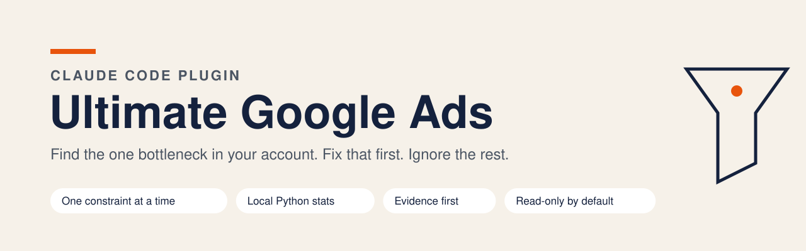
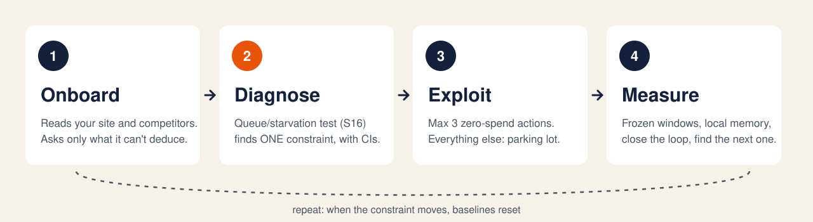
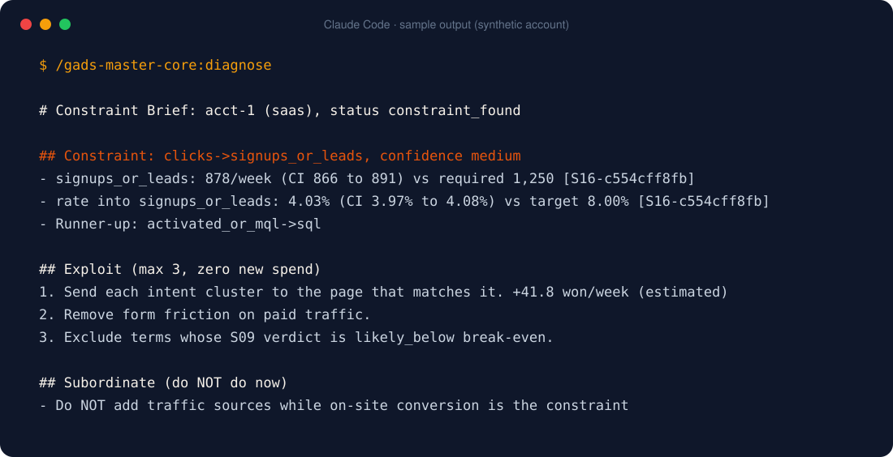

<picture>
  <source media="(prefers-color-scheme: dark)" srcset="assets/banner-dark.svg">
  
</picture>

<p align="center">
  <a href="https://github.com/yurikaminski/ultimate-google-ads-skills/stargazers"></a>
  
  
  
  <a href="LICENSE"></a>
  <a href="https://www.linkedin.com/in/yuri-kaminski/"></a>
</p>

<h3 align="center">10+ Claude skills analyzed + 15 years running ads for 100+ companies =<br>the Google Ads skill I wanted and couldn't find.</h3>

<p align="center">
  <b>If it saves you one bad optimization, <a href="https://github.com/yurikaminski/ultimate-google-ads-skills/stargazers">star the repo ⭐</a></b>. It's how other marketers find it.
</p>

---

## The problem with Google Ads "audits"

Most AI skills for Google Ads do the same thing: pull 40 metrics, compare each one to a generic benchmark ("CTR below 2%!"), and hand you 25 recommendations.

Then you touch everything, nothing moves, and you can't tell which change did what.

An account has **one bottleneck at a time**. Optimizing anything else is busywork with a nicer dashboard. This skill finds that bottleneck first, proves it with statistics, and tells you what **not** to touch while you fix it.

## What it does that the others don't

| | Typical AI audit | Ultimate Google Ads |
|---|---|---|
| **Output** | 25 recommendations | **1 constraint**, max 3 actions, everything else in a parking lot |
| **Thresholds** | "QS < 7 is bad" for everyone | Compared to **your own account's baseline** |
| **Math** | The LLM eyeballs numbers | **Local Python stats** (confidence intervals, Bayesian shrinkage, lag maturity). Every number cites a result id |
| **Low data** | Confident verdict anyway | **First line warns you**, findings marked indicative, confidence capped |
| **Context** | 30-question form | **Reads your site and competitors first**, asks only what it can't deduce (max 7) |
| **Memory** | Starts from zero every time | Remembers decisions, freezes changes inside measurement windows, flags flip-flops |
| **Your data** | Often a hosted third-party connector | **Stays on your machine**. No hosted MCP, credentials never stored |

## How it works

<picture>
  <source media="(prefers-color-scheme: dark)" srcset="assets/how-it-works-dark.svg">
  
</picture>

It's [Theory of Constraints](https://en.wikipedia.org/wiki/Theory_of_constraints) applied to your funnel. For each stage (impressions, clicks, leads, MQL, SQL, won, or the ecommerce equivalent) it computes the volume you **need** to hit your target and checks, with confidence intervals, whether you're starving or queueing. The first starving stage is your constraint. An operational signal (lost impression share, uncontacted leads, spend on terms below break-even) raises confidence.

## What you get



A **Constraint Brief**: the constraint with its evidence, a runner-up, what would prove it wrong, up to 3 zero-spend actions with expected impact and rollback, the "do NOT do now" list, and a dated next review. Sample above is from a synthetic test account.

## Quickstart (2 minutes)

**1. Add the marketplace and install** (inside Claude Code):

```
/plugin marketplace add yurikaminski/ultimate-google-ads-skills
/plugin install gads-master-core@ultimate-google-ads
```

**2. Ask:**

```
Optimize my Google Ads account
```

**3. Answer what it asks.** It starts with your site and 2-3 competitors, investigates, shows you what it understood, then asks for the few numbers it can't find (your target, margin, sales cycle). On first run it asks once to install its Python packages into a private environment (`~/.gads-master/venv`). Nothing touches your system Python.

Data input in v0.1 is CSV exports from Google Ads, GA4 or your CRM. The skill tells you exactly which columns it needs.

## What's inside

| Plugin | Status | What it does |
|---|---|---|
| `gads-master-core` | ✅ **v0.1** | Onboarding by investigation, TOC diagnosis, local stats engine, per-account memory, 4 audit subagents |
| `gads-master-api` | 🛠 v0.2 / v0.3 | Google Ads API read access, then writes behind a mutation gate (approval, dry run, rollback, new campaigns always PAUSED) |
| `gads-master-intel` | 🛠 v0.4 | Auction insights, compliant SERP sampling, Search Console, SEO x Paid matrix |

Playbooks: **SaaS** and **Ecommerce** are complete. App, marketplace, lead gen and local are next.

## Roadmap

- [x] **v0.1**: onboard, diagnose, stats S01 S04 S09 S15 S16, memory, SaaS and ecommerce playbooks
- [ ] **v0.2**: Google Ads API, read only
- [ ] **v0.3**: gated writes, weekly ritual, pacing, forecast, experiments, creative, attribution, report, remaining stats
- [ ] **v0.4**: competitive intel and SEO x Paid cross-learnings

Want a module sooner? [Open an issue](https://github.com/yurikaminski/ultimate-google-ads-skills/issues) and tell me what you'd use it for. Stars decide the order. ⭐

## Rules it never breaks

- No generic negative-keyword lists. Every negative needs evidence from your own search terms.
- No scraping Google search results. No clicking competitor ads.
- No invented "account health score".
- Read-only by default. Pages, ads and competitor copy are treated as untrusted data: instructions inside them are ignored.

## Privacy: what stays local

| Data | Where it goes |
|---|---|
| Exports, funnel data, statistics | Computed locally in Python. The stats package has no network code |
| Business context, decisions, baselines | `<workspace>/.gads-master/<account_id>/`, plain files you can read and delete |
| Public web pages (onboarding) | Only sites you name, robots.txt respected, only structured signals kept |
| Credentials | Never stored |

## Under the hood

- Statistics: Wilson and exact Poisson intervals, bootstrap ratios, conversion-lag maturity and nowcasting, empirical-Bayes beta-binomial shrinkage (replaces "50 clicks and no conversion, pause it"), data-quality checks, and the queue/starvation constraint test.
- 58 tests, including a planted-constraint suite: synthetic accounts with a known bottleneck in every funnel stage. The engine found the planted constraint in 360 of 360 runs.
- Platform facts that change (API auth, product sunsets) live in a dated claims ledger with sources and verification status.

```bash
python3 plugins/gads-master-core/scripts/run.py setup
~/.gads-master/venv/bin/python -m pip install pytest
cd plugins/gads-master-core/tests && ~/.gads-master/venv/bin/python -m pytest -q
```

## About the author


**Yuri Kaminski.** 15 years running paid media for 100+ companies. I build, validate, then teach, in that order. This skill is how I actually diagnose accounts, packaged so Claude can do it with you.

[](https://www.linkedin.com/in/yuri-kaminski/)

<br clear="left">

---

<p align="center">
  <b>Found it useful? <a href="https://github.com/yurikaminski/ultimate-google-ads-skills/stargazers">Star the repo ⭐</a> and share it with the person who manages your ads.</b>
</p>

<sub>Credits: concepts studied from AgriciDaniel/claude-ads, irinabuht12-oss/marketing-skills and ivangfalco/ads-skills, reimplemented from scratch (see [NOTICE](NOTICE)). Directory submission notes: [docs/SUBMISSION-CHECKLIST.md](docs/SUBMISSION-CHECKLIST.md). License: [MIT](LICENSE).</sub>
